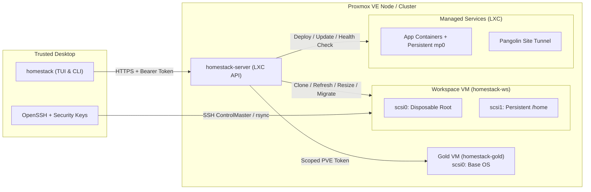

# HomeStack

**Disposable Proxmox VE development workspaces and declarative LXC service deployments—managed from a single TUI and CLI.**

HomeStack turns a Proxmox VE host or cluster into a self-hosted cloud for developer environments and lightweight services. Spin up full-VM workspaces where the root filesystem is disposable cattle (`scsi0`, cloned from your **Gold** base VM) and `/home` lives on a dedicated persistent volume (`scsi1`). Whenever a workspace gets cluttered or you update system packages in Gold, run `homestack refresh` to swap the OS disk in place—without touching your code, credentials, or home directory.

Alongside VM workspaces, HomeStack deploys and updates unprivileged Proxmox LXC services directly from OCI images and repository `.homestack/` manifests, complete with persistent storage, health-checked rolling updates, and optional [Pangolin](https://github.com/fosrl/pangolin) reverse-tunnel exposure.

---

## Key Capabilities

- **Disposable OS Root, Persistent `/home`** — Every workspace separates `scsi0` (disposable root cloned from `homestack-gold`) from `scsi1` (persistent `ext4` volume mounted at `/home/<USER>`). Refreshing stages a clean root from Gold, verifies guest readiness via QEMU Guest Agent, preserves SSH host keys, and rolls back automatically on failure.
- **No Standing Proxmox Root Access** — Root access (over SSH or an authenticated [Herdr](https://herdr.dev) terminal pane) is required only during installation or uninstallation. Day-to-day operations run over HTTPS against `homestack-server` LXC containers using least-privilege Proxmox API tokens.
- **Hardware-Key SSH by Default** — Automatically manages isolated OpenSSH configs and per-workspace `known_hosts` files under `~/.ssh/config.d/homestack/`, keeping your main `~/.ssh/known_hosts` clean across root refreshes and workspace recreations.
- **Unified Workspace Setup (`homestack setup`)** — Provision shell environments (`bash`, `zsh`, `fish`, `nu`), coding agents and toolchains (`claude`, `codex`, `opencode`, `hermes`, `pi`, `herdr`, `rust`, `agent-telemetry`), dotfiles, structured config patches (`toml`, `json`, `yaml`), and GitHub repositories with per-workspace Ed25519 deploy keys over a single SSH `ControlMaster` connection.
- **Declarative OCI-to-LXC Services** — Define services in `.homestack/services/<id>/` manifests and deploy them as unprivileged LXC containers backed by OCI images, with dedicated persistent volumes, health checks, rolling updates (`homestack update`), and optional Pangolin subdomain routing.
- **Full-Screen TUI & Scriptable CLI** — Manage workspaces, inspect cluster storage and orphan volumes, resize disks online, migrate across nodes, and deploy services interactively—or automate workflows with `--yes` and `--json`.

---

## Architecture



### Proxmox Tags & Roles

HomeStack identifies and protects VMs and containers using Proxmox tags:

| Tag | Target | Purpose |
| :--- | :--- | :--- |
| `homestack-gold` | QEMU VM | User-maintained base VM (`scsi0` root only) cloned during `create` and `refresh`. |
| `homestack-ws` | QEMU VM | Managed workspace with disposable `scsi0` root and persistent `scsi1` home (`HS_HOME_<VMID>`). |
| `homestack-lock` | QEMU VM | Optional tag alongside `homestack-ws` that blocks `refresh` to protect customized roots. |
| `homestack-alien` | QEMU VM | Unmanaged VM opted into `homestack setup`, `repo`, and `addkey` while lifecycle operations remain disabled. |
| `homestack-server` | LXC container | Image-backed service container (`homestack-api` instances and managed `.homestack/` services). |

---

## Quick Start

### 1. Prerequisites & Build

Build from source with Rust (via the repository Cargo wrapper, which serializes builds and cleans intermediate artifacts):

```sh
python3 scripts/cargo.py build --locked -p hs-cli --bin homestack
```

Place `./target/debug/homestack` (and `homestack-deploy` if running standalone service deployments) on your `PATH`.

**Desktop tools:**
- `ssh` / `ssh-keygen` (OpenSSH) and `rsync`
- `gh` (optional, authenticated GitHub CLI for repository discovery and deploy-key registration)
- `herdr` (optional, for Herdr pane installation access and workspace session management)
- `bwrap` and `fido2-token` (optional, when filtering visible FIDO2 security keys via `fido_devices`)

### 2. First-Time Installation

Run `homestack` (launches the TUI) or `homestack install`:

1. **Access** — Connect once as `root` to any node in your Proxmox cluster over SSH or an authenticated Herdr pane.
2. **Discover** — Inspect cluster nodes, storages, network bridges, and candidate Gold VMs (`homestack discover --json` for read-only inspection).
3. **Configure** — Select storage pools, network CIDR/gateway/DNS, workspace username/UID/GID, default `/home` size, SSH keys, and `homestack-server` API endpoints.
4. **Review & Apply** — Inspect the planned Proxmox roles, ACLs, pools, tokens, Cloud-Init snippets, and LXC API deployments before applying. Configuration and scoped credentials are written to `~/.config/homestack/` (use `--profile <NAME>` for multiple clusters or environments).

---

## CLI Overview

Mutating commands always display an execution plan before confirmation. Pass `--yes` (`-y`) for non-interactive execution and `--json` for machine-readable output.

| Command | Description |
| :--- | :--- |
| `homestack` | Launch the interactive terminal UI (TUI). |
| `homestack status [VMID\|NAME]` | Cluster-wide overview (workspaces, Gold, storage capacity, services) or detailed single-VM inspection. |
| `homestack create <VMID> <NAME>` | Clone Gold into a new workspace, allocate its persistent `/home` disk, configure Cloud-Init, and register its SSH alias. |
| `homestack refresh <VMID\|NAME>` | Replace the workspace's `scsi0` root disk with a fresh clone from Gold while preserving `scsi1` (`/home`). |
| `homestack resize <VMID\|NAME>` | Grow `--root-size <SIZE>` or `--home-size <SIZE>` online (Proxmox volume + partition/LUKS/LVM + `ext4`/`btrfs`). |
| `homestack migrate <VMID\|NAME> <NODE>` | Migrate a stopped workspace and its disks to another cluster node (`--target-storage <ID>`). |
| `homestack destroy <VMID\|NAME>` | Delete a workspace VM and its attached persistent `/home` volume after verifying identity. |
| `homestack addkey <VMID\|NAME>` | Add an SSH public key (`--key <PATH.pub>`) or repair configured keys via Cloud-Init and QEMU Guest Agent. |
| `homestack setup [WORKSPACE] [SELECTORS...]` | Inspect or provision shells, coding agents, dotfiles, config patches, credentials, and repositories. |
| `homestack repo <VMID\|NAME> [OWNER/REPO]` | Generate or rotate a workspace-local GitHub deploy key and clone or fast-forward the repository. |
| `homestack update [SERVICE...]` | Rolling-update deployed HomeStack LXC services to their latest published OCI releases (`--auto` waits for active CI builds). |
| `homestack install` / `uninstall` | Install, reconcile, or remove HomeStack Proxmox roles, pools, tokens, snippets, and API containers. |
| `homestack discover` / `profiles` / `transport` | Inspect unconfigured clusters, list client profiles, or view active API transport endpoints. |

### Common Examples

```sh
# Create a workspace (default or explicit node, storage, and persistent /home size)
homestack create 200 dev-box --home-size 100G
homestack create 201 gpu-worker --node pve2 --storage nvme-pool --home-size 500G

# Refresh OS root from Gold or grow disks online without rebooting
homestack refresh dev-box
homestack resize dev-box --home-size 250G

# Provision shells, coding agents, and a GitHub repository over a single SSH connection
homestack setup dev-box
homestack setup dev-box env=bash app=claude,codex,rust repo=owner/project --yes
homestack setup ALL env=bash app=claude --dry-run

# Update all deployed LXC services across the cluster
homestack update -y
```

---

## Workspace Setup & Customization (`homestack setup`)

`homestack setup` runs from your desktop over a single SSH `ControlMaster` session as the unprivileged workspace user. State and pre-change file snapshots are recorded inside the workspace's persistent home (`~/.local/state/homestack/`), so setup history survives OS root refreshes.

| Group | Selector | Capabilities |
| :--- | :--- | :--- |
| **Applications** | `app` / `a` | Built-in installers (`claude`, `codex`, `opencode`, `opencode-v2`, `hermes`, `pi`, `herdr`, `rust`, `agent-telemetry`, `git`) plus custom `[[setup.items]]` entries. |
| **Environment** | `env` / `e` | Shell startup profiles (`bash`, `zsh`, `fish`, `nu`) and managed environment variables (`exports`). |
| **Repositories** | `repo` / `r` | Per-workspace Ed25519 deploy-key generation, GitHub registration via desktop `gh`, and safe `git clone` / `--ff-only` updates. |
| **Credentials** | `cred` / `c` | Explicit credential transfers (executed last with strict `0600` user-only permissions). |

You can extend built-in tools or define custom items in `~/.config/homestack/client.toml` with file transfers (`files`) and format-aware configuration patches (`config_files` for `toml`, `json`, and `yaml` that modify only declared keys while preserving comments and existing user settings):

```toml
[[setup.items]]
id = "codex"
files = ["~/.codex/instructions.md"]

[[setup.items.config_files]]
path = "~/.codex/config.toml"
format = "toml"
values = { tui = { status_line_use_colors = true } }
```

---

## Declarative Services & Built-In Ecosystem

From the Setup TUI (**Services** group) or CLI (`homestack update`), HomeStack deploys and manages unprivileged Proxmox LXC containers defined by `.homestack/services/<id>/` manifests in any repository. Each service gets deterministic static IP allocation, an isolated persistent mount (`mp0`), automated post-boot and post-restart health verification, and optional public or private exposure through Pangolin.

This repository ships several built-in infrastructure and observability services:

| Service | Path | Description |
| :--- | :--- | :--- |
| **`homestack-api`** | `crates/hs-server`, `.homestack/services/homestack-api` | Cluster API server handling workspace lifecycle, storage checks, and service orchestration. |
| **`pangolin`** | `deploy/pangolin-site`, `.homestack/services/pangolin` | Managed Pangolin Newt tunnel container for exposing services without opening inbound firewall ports. |
| **`otel`** | `deploy/otel`, `.homestack/services/otel` | Derived OpenTelemetry Collector for logs, metrics, and AI coding agent telemetry. |
| **`metrics`** | `crates/hs-metrics`, `.homestack/services/metrics` | Proxmox cluster, node, VM/LXC, and storage metrics collector and dashboard. |
| **`pve-agent`** | `crates/hs-pve-agent`, `deploy/pve-agent` | Lightweight Debian package daemon installed on Proxmox nodes for host and filesystem telemetry. |
| **`ai-usage`** | `crates/hs-usage`, `.homestack/services/ai-usage` | Usage and rate-limit dashboard for Claude Code and Codex across workspaces. |
| **`agent-accounts`** | `crates/hs-agent-accounts`, `.homestack/services/agent-accounts` | Centralized OAuth account pool, quota tracking, and credential rotation for AI coding agents. |

---

## Preparing a Gold Base VM

Gold is a standard QEMU VM that you maintain and customize with your preferred OS packages. To work with HomeStack, configure the VM in Proxmox with:

1. **Tag & Disks:** Tag the VM `homestack-gold`. Attach the OS root disk as `scsi0` (bootable). Do **not** attach `scsi1`—HomeStack allocates `scsi1` (`/home`) per workspace.
2. **Hardware:** Configure primary networking on `net0`, attach a **Cloud-Init** drive with at least one SSH public key, and enable the **QEMU Guest Agent** option.
3. **Guest OS Baseline (Debian/Ubuntu):** Ensure `root` and the workspace user (`UID 1000` / `GID 1000` by default) exist, install baseline packages, and clean Cloud-Init state right before shutting down:

```sh
apt-get update && apt-get install -y cloud-init qemu-guest-agent network-manager openssh-server e2fsprogs util-linux rsync git
systemctl enable qemu-guest-agent NetworkManager ssh
cloud-init clean --logs --machine-id && poweroff
```

> [!IMPORTANT]
> Whenever you boot Gold to update system packages, run `cloud-init clean --logs --machine-id` again immediately before `poweroff` so cloned workspaces generate fresh machine IDs and SSH host keys.

---

## Documentation & Development

- **Operations & Design Docs:**
  - [Client profiles](docs/client-profiles.md)
  - [Proxmox permissions & token scopes](docs/proxmox-permissions.md)
  - [Managed API and Pangolin services](docs/internal-services.md)
  - [Service deployment, replacement, and deletion](docs/service-replacement.md)
  - [Agent Accounts service](deploy/agent-accounts/README.md)
  - [AI telemetry attribution](docs/ai-telemetry.md)
  - [PVE metrics & node agent operations](docs/pve-metrics-operations.md)
  - [OpenAPI specification](docs/openapi.json)
  - [Isolated E2E bootstrap](docs/e2e-bootstrap.md) & [E2E laboratory design](docs/isolated-e2e-lab.md)

### Building & Checking

Always use `scripts/cargo.py` or `scripts/check.sh` instead of raw `cargo` commands so disposable build artifacts are cleaned up without disturbing `target/` E2E lab state:

```sh
scripts/check.sh          # Format check and binary compilation
scripts/check.sh --full   # Retained automated checks and static analysis
```

Repository workflow and release policies are documented in [AGENTS.md](AGENTS.md).
