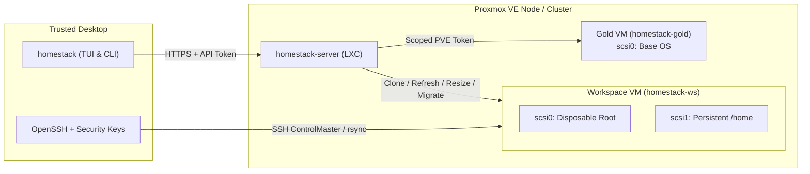

# HomeStack

**Disposable Proxmox VE development workspaces with persistent `/home` disks, hardware-key SSH, and one-step user-space provisioning.**

HomeStack lets you treat your workspace operating system as cattle while keeping your work, credentials, and home directory safe on a dedicated persistent volume. Spin up a workspace from a **Gold** base VM, work inside it over SSH, and whenever the root filesystem gets cluttered or you update system packages in Gold, run `homestack refresh` to swap the OS disk in place—without touching `/home`.

<!-- Screenshots placeholder -->

---

## Why HomeStack?

- **Disposable OS root, persistent `/home`** — Every workspace has two disks: `scsi0` (disposable root cloned from your `homestack-gold` VM) and `scsi1` (persistent `ext4` volume mounted at `/home/<USER>`). Refreshing a workspace stages a fresh root from Gold, verifies guest health, and rolls back automatically if anything fails.
- **No permanent Proxmox root access** — Root access (via SSH or an authenticated [Herdr](https://herdr.dev) pane) is used only when installing or uninstalling HomeStack. Day-to-day operations run from the desktop client against lightweight `homestack-server` LXC containers that use least-privilege Proxmox API tokens.
- **Full-screen TUI & scriptable CLI** — Manage workspaces, inspect storage capacity, start/stop Gold, add SSH keys, run rolling API server updates, and provision tools interactively with keyboard and mouse—or script everything with `--yes` and `--json`.
- **Hardware-key SSH by default** — Generates isolated OpenSSH aliases under `~/.ssh/config.d/homestack/` with per-workspace `known_hosts` files (`StrictHostKeyChecking accept-new`), keeping your main `~/.ssh/known_hosts` clean across root refreshes and workspace recreations.
- **Unified workspace setup (`homestack setup`)** — Provision shell profiles (`bash`, `zsh`, `fish`, `nu`), coding agents and toolchains (`codex`, `claude`, `opencode`, `hermes`, `pi`, `herdr`, `rust`), dotfiles, structured config patches (`toml`, `json`, `yaml`), GitHub repositories with per-workspace deploy keys, and nightly `bk` backups over a single SSH `ControlMaster` session.

---

## How It Works



### Proxmox Tags & Roles

HomeStack identifies and guards VMs and containers using Proxmox tags:

| Tag | Target | Purpose |
| :--- | :--- | :--- |
| `homestack-gold` | QEMU VM | User-maintained base VM (`scsi0` root only) cloned for `create` and `refresh`. |
| `homestack-ws` | QEMU VM | Managed workspace with disposable `scsi0` root and persistent `scsi1` home (`HS_HOME_<VMID>`). |
| `homestack-lock` | QEMU VM | Optional tag added alongside `homestack-ws` to block `refresh` and protect customized roots. |
| `homestack-alien` | QEMU VM | Existing non-HomeStack VM opted into `homestack setup`, `repo`, and `addkey` while lifecycle operations remain disabled. |
| `homestack-server` | LXC container | Image-backed service container, including installer API instances (`api1`, `api2`, …) and common service deployments. |

Common deployments identify the service in their Proxmox description, for example
`HomeStack service homestack-api` or `HomeStack service pangolin`. The API manifest
ID `homestack-api` is distinct from the `homestack-server` tag and image name.
See [internal services](docs/internal-services.md) for API and Pangolin deployment
and [service replacement](docs/service-replacement.md) for optional persistent
home, image updates, recovery and explicit deletion.

---

## Quick Start

### 1. Build the binary

Build with Rust 1.99 or newer. The client and server are Rust binaries. Python 3
runs the repository build wrapper, embedded guest setup programs and remote
Pangolin integration helpers; retain it on the hosts used by those workflows:

```sh
python3 scripts/cargo.py build --locked -p hs-cli --bin homestack
./target/debug/homestack
```

Place `homestack` (and `homestack-deploy` if deploying from PATH) in your `PATH`.

**Desktop prerequisites:**
- `ssh` / `ssh-keygen` (OpenSSH)
- `rsync` (for Setup file transfers)
- `gh` (optional, authenticated GitHub CLI for `homestack repo` and Setup repository discovery)
- `herdr` (optional, for Herdr pane installation access and automatic workspace machine registration)
- `bwrap` and `fido2-token` (optional, when using `fido_devices` to filter visible FIDO2 security keys)

### 2. First-time installation

Run `homestack` (opens the TUI) or `homestack install` without an existing configuration:

1. **Access** — Connect as `root` to any node in your Proxmox cluster over **SSH** (`root@pve1`) or an already authenticated **Herdr** terminal pane.
2. **Check** — Inspect discovered nodes, storages, network bridges, and candidate Gold VMs.
3. **Settings** — Select Gold (optional during initial install), workspace disk storages, snippet/template storages, server domain (or `--no-servers`), network CIDR/gateway/DNS, workspace username/UID/GID, default `/home` size, and desktop SSH identity files.
4. **Review & Install** — Review every Proxmox and deployment action before anything changes. Interrupted answers are saved in a draft (`install-draft.toml`) and restored automatically when you reopen the installer.

```sh
homestack                 # Open the TUI (starts first-time setup if unconfigured)
homestack discover --json # Read-only cluster discovery
homestack install         # Interactive or flag-driven CLI installer
homestack uninstall       # Remove HomeStack roles, pools, tokens, and unused vendor snippets
```

> [!TIP]
> `config.minimal.toml` is an optional installation seed, not an active client configuration. After confirmation, the installer generates `client.toml`, `server.toml`, and scoped tokens under `~/.config/homestack/`.

See [Proxmox permissions](docs/proxmox-permissions.md) for the installer's exact
role lists, ACL scopes, token privilege separation and permission repair.

### 3. Client profiles

The default profile lives under `~/.config/homestack` (or `$XDG_CONFIG_HOME/homestack`). Named profiles keep independent credentials, SSH aliases, and UI preferences:

```sh
homestack --profile e2e
homestack profiles
```

Use `--config PATH` to point at an explicit `client.toml` outside a named profile. See [Client profiles](docs/client-profiles.md) for details.

Inside the TUI (`Menu` / `m`):
- **Settings › General › Reinstall HomeStack** opens the full installer with your saved settings pre-filled.
- A yellow `↑` immediately before a container name means a newer HomeStack image is available. The client checks API images directly at startup alongside the main status read. `API ↑N` in the panel border reports available API updates; `API ?` reports an incomplete check.
- **Update API containers** performs a rolling update of `homestack-server` LXC containers across cluster nodes using the saved deployment configuration.
- **Settings › General › Uninstall HomeStack** removes HomeStack's Proxmox user, tokens, roles, ACLs, pools, and unused vendor Cloud-Init snippets, retires `client.toml` to `client.toml.uninstalled`, and returns cleanly to the first-time setup screen.

Views **2** and **3** show an aligned storage table, `/home` usage, detached
volumes, and backup ages. On narrow terminals, content columns use a fixed legend:
`I` images, `R` rootdir, `B` backup, `O` iso, `S` snippets, `T` vztmpl; `*` marks
shared storage. Used capacity becomes red at 85%. Refreshes keep the previous data
visible, sort content and node lists, and ignore results that only reorder items.
The orphan scan checks disk references of all visible VMs, including every Gold
across pools and `unusedN` entries. An unreadable VM configuration leaves the
scan incomplete and prevents unverified candidates from being reported as orphans.

---

## CLI Reference

Lifecycle commands accept either a numeric `VMID` or an exact workspace name. Mutating commands (`create`, `refresh`, `resize`, `migrate`, `destroy`, `addkey`) always display an execution plan before confirmation. Pass `--yes` to accept the plan and `--json` for machine-readable output.

| Command | Description |
| :--- | :--- |
| `homestack` | Launch the interactive terminal UI (TUI). |
| `homestack status [VMID\|NAME]` | Cluster-wide overview (workspaces, Gold, storage capacity, detached volumes) or detailed single-VM inspection. |
| `homestack create <VMID> <NAME>` | Clone Gold into a new workspace, allocate its persistent `/home` disk, configure Cloud-Init, and register its SSH alias. |
| `homestack refresh <VMID\|NAME>` | Replace the workspace's `scsi0` root disk with a fresh clone from Gold while preserving `scsi1` (`/home`). |
| `homestack resize <VMID\|NAME>` | Grow `--root-size <SIZE>` or `--home-size <SIZE>` online (Proxmox disk + partition/LUKS/LVM + `ext4`/`btrfs`). |
| `homestack migrate <VMID\|NAME> <NODE>` | Offline-migrate a workspace and its disks to another cluster node (`--target-storage <ID>`). |
| `homestack destroy <VMID\|NAME>` | Delete a workspace VM and its attached persistent `/home` volume after verifying identity. |
| `homestack addkey <VMID\|NAME>` | Add an SSH public key (`--key <PATH.pub>`) or re-apply configured keys via Cloud-Init without touching `/home`. |
| `homestack setup [WORKSPACE] [SELECTORS...]` | Inspect or provision dotfiles, shell environments, applications, credentials, backups, and repositories. |
| `homestack repo <VMID\|NAME> [OWNER/REPO]` | Provision or rotate a workspace-local GitHub deploy key and clone/fast-forward the repository. |
| `homestack install` / `uninstall` | Install, reconcile, or remove HomeStack on Proxmox VE and deploy `homestack-server` containers. |
| `homestack discover` | Read-only Proxmox cluster inspection prior to installation. |
| `homestack profiles` | List available client profiles. |
| `homestack transport` | Show active API server transport and endpoint configuration. |

### Common Lifecycle Examples

```bash
# Create workspaces on the default node/storage or on a specific node and storage
homestack create 200 example-workspace
homestack create 200 example-workspace --home-size 20G
homestack create 200 example-workspace --storage example-storage
homestack create 200 example-workspace --node pve-example-2 --storage example-storage --home-size 500G

# Refresh OS root from Gold, resize disks online, migrate, or destroy
homestack refresh 200
homestack resize 200 --root-size 32G
homestack resize 200 --home-size 500G
homestack migrate 200 pve-example-2 --target-storage example-storage
homestack destroy 200

# Manage SSH keys and repositories
homestack addkey 200 --key ~/.ssh/id_ecdsa_sk_trezor_vm.pub
homestack addkey 200
homestack repo example-workspace
homestack repo example-workspace owner/repository

# Inspect cluster or workspace status
homestack status
homestack status 200
```

### Cross-Node Creation & Migration

- `create --node NODE` selects the workspace destination; omitting it uses Gold's node. `--storage` selects an allowed storage on the destination for root and home; otherwise HomeStack selects the first configured storage for that node.
- When creating on another node, the server creates a full clone on Gold's node, then migrates the stopped clone and its disks to the destination through the Proxmox API. It verifies the migrated disks and network configuration before allocating the persistent home and preparing Cloud-Init. Both nodes must be online and provide the required storage and bridges. Gold is not modified by this transfer. Failed-clone cleanup requires proof that the VM and its disks belong to the target operation; an unrecognized VM or foreign disk is left intact.

### Online Disk Resize (`homestack resize`)

- `resize` accepts one disk per invocation: `--root-size` or `--home-size`, specified as an absolute total disk size such as `32G` or `1T`.
- It grows the Proxmox disk and mounted `ext4` or single-device `Btrfs` filesystem online, including a partition, LUKS mapping, and LVM layers when present. Btrfs subvolumes are resolved to their backing device before resizing.
- The standard two-disk root/home layout is supported; the selected partition must be last on its disk. LVM requires a dedicated volume group with one physical volume and one ordinary linear logical volume; the logical volume grows into all available space in that group. Shrinking, thin pools, RAID, and shared/multi-volume groups are rejected before disk growth.
- The VM must be running with a working QEMU Guest Agent and the filesystem tool (`resize2fs` or `btrfs`). Layer-specific tools (`growpart`, `cryptsetup`, and LVM utilities) are checked before execution.
- For LUKS, HomeStack reads the matching `/etc/crypttab` entry. A configured regular key file is validated and used entirely inside the guest. If no key file is configured, interactive execution asks for a passphrase without echo; the client sends it in the HTTPS apply request, and the server passes it to `cryptsetup` through guest-agent standard input, never command arguments. Non-interactive execution requiring a passphrase stops before disk growth. A missing or invalid configured key file is reported without switching authentication methods.
- Repeating the same target size completes interrupted growth, including LUKS/LVM/filesystem stages, without further enlarging the virtual disk. `homestack-lock` blocks only `refresh` and does not prevent `resize`. A later refresh replaces root with the Gold disk again; use `homestack-lock` to protect customized roots.

### Adding & Repairing SSH Keys (`homestack addkey`)

- **In the TUI:** **Add key** lists public keys with checkboxes. Each row shows the key's comment (its name) and `.pub` file. Use `↑`/`↓` to move, `Space` or click to select several keys, and `Enter` to review and apply the entire selection once. For native workspaces, the separate *"Apply the keys already configured in the VM"* option repairs access without selecting a new file. For a running `homestack-alien` VM, **Add key** instead copies the selected public keys over its SSH alias into the login account's `~/.ssh/authorized_keys` (preserving existing keys and restrictions, without changing Cloud-Init, VM tags, or power state).
- **In the CLI:** `addkey` adds one SSH public key (a `.pub` file with a single key and comment) to a workspace through Proxmox Cloud-Init without touching the root disk or persistent home:
  1. Adds the key to the VM's Proxmox `sshkeys`.
  2. Sets `cicustom` to the static HomeStack keep vendor snippet, replacing any previous custom snippet references. Proxmox generates user, network and meta data from the VM options; the keep snippet never formats home or resets its permissions.
  3. On a running VM, appends missing keys to `root`'s and the workspace user's `authorized_keys` through QEMU Guest Agent and verifies them, without requiring SSH access or removing existing keys.
  4. Updating `sshkeys` changes Proxmox's generated Cloud-Init instance ID, so the keep snippet applies the keys at the next start. If the guest agent is unavailable, immediate application is deferred until that start.
  5. For a running VM, asks before restarting (`--yes` alone never restarts a VM; pass `--restart` to restart without prompting), shuts it down and starts it, waits for Cloud-Init to report `done`, removes the workspace's local `known_hosts` file (`~/.ssh/config.d/homestack/known_hosts/vm<VMID>`), and verifies the key in both `authorized_keys` files. A stopped VM stays stopped and applies the key on its next start.
  6. Without `--key`, `homestack addkey <WORKSPACE>` re-applies the keys already in Proxmox `sshkeys` (for example, to recreate a deleted `authorized_keys`).
  7. After adding a new key, the matching private key is added to `identity_files` in the HomeStack config and the VM's local SSH config is rewritten (YubiKey first, Trezor when no YubiKey is connected).

---

## Workspace SSH & Security Keys

Root access is needed once for Proxmox account, role, pool, and token installation. Normal workspace operations go through the HTTPS API servers and scoped tokens. Workspace SSH and setup use the desktop's selected identities and verified host keys.

Configure generated workspace SSH entries in `[workspace_ssh]`; its user matches the workspace account in `[user]`. `identity_files` contains the desktop private-key paths selected during installation. Optional `fido_devices` limits the security-key kinds visible to SSH (requires `bwrap` and `fido2-token`).

- **OpenSSH aliases:** After a successful `create`, HomeStack writes and `fsync`s a mode-`0600` workspace entry below `~/.ssh/config.d/homestack/`, atomically publishes it, and only then removes stale entries for the same VMID. Ensure your `~/.ssh/config` includes `~/.ssh/config.d/homestack/*.conf`.
- **Isolated `known_hosts`:** Each workspace entry points to its own host-key file at `~/.ssh/config.d/homestack/known_hosts/vm<VMID>` with `StrictHostKeyChecking accept-new`. OpenSSH learns the workspace's key on first connection and verifies it thereafter, without reading or polluting `~/.ssh/known_hosts`. `refresh`, `addkey` (after restart), and `destroy` remove only that workspace's file.
- **TUI SSH action:** Connects through the VM's name as an OpenSSH alias (e.g. `ssh rt`), preserving your desktop's `Host`, `Match`, identity, and proxy settings. Gold uses `root@ALIAS`. Authentication is restricted to public keys, so an unplugged hardware key reports an authentication failure instead of falling back to a password prompt.
- **Single ControlMaster for Setup:** One SSH `ControlMaster` connection is established and reused across guest checks, directory creation, `rsync`, verification, and setup handlers. Fresh authentication is disabled on child connections so a broken socket fails closed instead of prompting for repeated security-key touches.

---

## Unified Workspace Setup (`homestack setup`)

`setup` is an explicit user-space operation, independent of `install`, `create`, `refresh`, and `migrate`. It runs on the trusted desktop, resolves the workspace through verified infrastructure, and operates as the unprivileged workspace user. Nothing is selected automatically.

```bash
# Desktop catalog discovery (no guest SSH connection required)
homestack setup list
homestack setup list --json

# Read-only live state inspection of one workspace
homestack setup status hermes
homestack setup status hermes --json

# Interactive full-screen selector (authenticates one SSH ControlMaster before opening the TUI)
homestack setup hermes

# Select by 1-based catalog index or stable ID
homestack setup hermes e=1 a=1,2
homestack setup hermes env=1 app=1 --catalog CATALOG_ID --dry-run
homestack setup hermes env=bash app=codex,opencode --yes
homestack setup hermes repo=hipotures/homestack --yes
homestack setup hermes app=bk --yes
homestack setup 200 env=bash app=codex --dry-run
homestack setup hermes env=bash app=codex --yes --non-interactive --json
```

### Setup Categories & Built-in Catalog

| Group | CLI Keys | Built-in / Configured Items |
| :--- | :--- | :--- |
| **Files** | `files`, `f` | User-defined `[[setup.items]]` files and directories (`path = "~/notes/"`). |
| **Environment** | `env`, `e` | `bash`, `zsh`, `fish`, `nu` (generates complete shell startup configs with pre-apply backups). |
| **Applications** | `app`, `a` | `codex`, `claude`, `herdr`, `opencode`, `opencode-v2`, `pi`, `hermes`, `rust`, plus custom `[[setup.items]]`. |
| **Credentials** | `cred`, `c` | Explicit credential/file items (always executed last after all other groups). |
| **Backup** | `backup`, `b` | `bk` (nightly `systemd --user` archive backup + restricted desktop retrieval keys). |
| **Repositories** | `repo`, `r` | Repositories discovered from GitHub (`[repo] owner`) or explicitly named (`repo=owner/name`). |

- Select comma-separated 1-based indices or stable IDs. `0` or `all` selects the entire explicitly named category.
- Without selectors, an interactive terminal opens the full-screen TUI selector. With selectors, HomeStack prints a plan and asks for confirmation (`--yes` accepts the plan; `--dry-run` validates locally without opening guest SSH).
- `--non-interactive` and `--json` disallow interactive third-party installers unless a verified `non_interactive` recipe is configured. Hardware security keys may still require a physical touch.

### Built-in Application Highlights

- **Rust (`app=rust`):** Runs the official `rustup` installer with `-y --profile minimal`, sources `~/.cargo/env`, and verifies working `rustup`, `rustc`, and `cargo` in `~/.cargo/bin`.
- **Claude Code (`app=claude`):** Runs the official native installer (`curl -fsSL https://claude.ai/install.sh | bash`) into `~/.local/bin` and checks `claude --version`.
- **Herdr (`app=herdr`):** Installs the `herdr` binary only if missing, preserves an existing custom binary, writes `~/.config/systemd/user/herdr.service`, enables user linger without `sudo`, and registers the workspace on the desktop with `herdr machine add user@<vm> --label <vm> --remote-session default`. The service starts the installed binary without running `herdr update`. It uses `ExitType=cgroup` so a live handoff can replace the main server process without systemd terminating the replacement and its panes. Existing sessions are left running when applying service changes; an unmanaged server is not restarted or moved into the service.
- **Codex, OpenCode, Hermes, Pi (`app=codex`, `app=opencode`, `app=opencode-v2`, `app=hermes`, `app=pi`):** Follow their official upstream installers with explicit `HOME`, `PATH`, and live readiness checks.

### Customizing Items, Files & Structured Config Patches

Extend built-in items or declare new ones in `~/.config/homestack/client.toml` using `[[setup.items]]`:

```toml
[[setup.items]]
id = "codex"
label = "Codex CLI"
# Optional: attach desktop file copies or structured config patches to an application
files = ["~/.codex/instructions.md"]
```

- **Setup Files (application `files = [...]`):** Use `rsync` semantics without deleting unselected guest files. An ending slash denotes a directory. User-only permissions are enforced and file contents are never printed. A single application file copy can be selected via `app=claude:file:~/.claude/statusline.sh`.
- **Structured configuration patches (`config_files`):** Attach `config_files` tables (`path`, `format` = `"toml"` | `"json"` | `"yaml"`, and nested `values` tables) to an application entry. HomeStack parses the source document on the desktop, patches only the declared scalar and array leaves while preserving unrelated keys and comments, and reparses the merged result before writing. Individual leaves can be toggled in the TUI or selected via JSON Pointer syntax (e.g. `app=codex:config:/tui/status_line_use_colors`).
- **Application validators (`[setup.items.validation]`):** Supports `type = "exit-code"` (requires exit 0) or `type = "json-path"` (checks `path` against `accepted` values). On validation failure, structured files modified by that operation are restored from the pre-apply snapshot.
- **Explicit dependencies (`depends_on = ["ID"]`):** Requires the listed actions to be selected and orders them deterministically without silently pulling in unselected credentials or tools.

<details>
<summary><strong>Catalog snapshots, TUI controls & execution safety details</strong></summary>

#### Catalog identity and numbering
Listings include category index, stable ID, label, file path or repository identity, desktop availability, and repository timestamps. Repository discovery uses authenticated desktop `gh api` across all pages for `[repo] owner` (`sort = "recent"` | `"created"` | `"name"`). Each displayed catalog saves an immutable version-1 snapshot under `$XDG_STATE_HOME/homestack/catalogs/` (`~/.local/state/homestack/catalogs/`); pass `--catalog ID` to bind numeric selections to a specific snapshot across concurrent sessions.

#### Setup TUI controls
- **Left pane (checkbox tree):** Represents selection state for the current session. Detected installed/in-sync items are shown in green; selecting an already-ready item or one that overwrites existing configuration highlights it in red as an update/reapply warning.
- **Right pane (details):** Independently scrollable (`PageUp`/`PageDown`/mouse wheel) full item details.
- **Keys:** `↑`/`↓` move, `←`/`→` switch groups, `Enter` expands/collapses, `Space` toggles an item or branch, `0` selects the current branch, `f` filters visible items, `F5` refreshes live guest state, `Ctrl+R` reloads the catalog and refreshes state, and `a` opens **Review & apply**.
- **Services group:** after Repositories: the repositories (those with deployed services first), `Enter` reads and lists a repository's `.homestack/*.yaml` services with their published releases, `F5` reads them again. A service's state is what Proxmox shows: the containers whose description names it. `d` deploys new, independent instances: version (numeric `X.Y.Z` releases only), the nodes and storages (one row per node and storage; the disk and the home volume are new volumes there), one instance on each, CTIDs (empty takes the first free IDs whose derived IPs are also unallocated), sizes and non-secret environment, then a review, then unprivileged containers named `<id>`, `<id>-2`… in pool `homestack-service` through the deploy token, each with its own new volume at `/home/app` (`mp0`) and its health check passed before and after one restart. Nothing is removed on a failure. `m` grows a container's disks or removes containers with their homes; Enter on a container updates its image and `g` moves it to another node ([docs/service-replacement.md](docs/service-replacement.md)).

Service IP allocation checks current and pending static IPv4 settings on all LXC interfaces and VM Cloud-Init interfaces visible to the deploy token, including stopped guests. An unreadable guest blocks allocation. Manual CTIDs are checked during review, and addresses are checked again before creation or initialization recovery. Addresses configured only inside guests or on devices outside this inventory require separate network address management.

#### State registry and pre-apply snapshots
Setup state lives inside the workspace's persistent home at `~/.local/state/homestack/setup.json`, so destroying a workspace and its home cleanly removes its setup state. Copying or restoring the home to another workspace preserves its setup history even when the VMID changes. Setup verifies the current target independently; the next recorded action updates the registry's workspace metadata. Before overwriting any existing declared path, HomeStack creates an operation snapshot under `~/.local/state/homestack/YYYYMMDD_HHMMSS/` containing pre-change files, SHA-256 metadata (`snapshot.json`), and `setup.before.json`.

</details>

---

## BK Workspace & Local Backup (`app=bk`)

HomeStack includes **BK**, a lightweight archive backup manager with a `systemd --user` nightly timer (`03:15`, `Persistent=true`) and restricted desktop SSH retrieval keys.

```bash
# Install BK in a workspace (survives homestack refresh inside persistent /home)
homestack setup WORKSPACE app=bk

# Or install BK locally for the current desktop user
homestack setup --local app=bk
homestack setup --local status
```

- **Files installed:** `~/.local/bin/bk`, `~/.config/systemd/user/backup.service`, `~/.config/systemd/user/backup.timer`, and an initial `~/.config/bk/backup.yaml` (never overwrites an existing config):
  ```yaml
  version: 1
  destination: "/home/user/backup"
  retention: 7
  respect_gitignore: true
  sources:
    - "/home/user/.config/bk/backup.yaml"
  ```
- **Inside the workspace:** Run `bk edit` to choose backed-up paths, `bk run` for an immediate backup, and `bk status` to inspect the latest run and retained archives.
- **Restricted desktop retrieval keys:** For workspaces, Setup generates two passphrase-free Ed25519 key pairs on the desktop (`~/.ssh/homestack/backup/vm<VMID>-bk-archive` and `vm<VMID>-bk-status`) and installs restricted `authorized_keys` entries in the workspace that force `/usr/bin/cat --` on `/home/<USER>/backup/backup.tgz` or `/home/<USER>/backup/status.json` (no shell, no PTY, no port forwarding):
  ```bash
  ssh -T -F /dev/null -o BatchMode=yes -o IdentitiesOnly=yes \
    -o IdentityAgent=none -o ControlMaster=no -o ControlPath=none \
    -i ~/.ssh/homestack/backup/vm200-bk-status USER@WORKSPACE_IP x
  ```

---

## Repository Provisioning (`homestack repo`)

Repository provisioning can be run through `homestack setup WORKSPACE repo=OWNER/REPO` or as a standalone command:

```toml
[repo]
owner = "owner"
checkout_root = "~/DEV"
```

```bash
homestack repo WORKSPACE              # Uses [repo].owner + resolved workspace name
homestack repo WORKSPACE OWNER/REPO   # Explicit repository override
```

1. **Inspects** the workspace and GitHub state, then offers `Exit`, `Setup`, or `Rotate key`.
2. **Generates** an Ed25519 deploy-key pair inside the workspace's persistent home (`~/.ssh/homestack/github/`). The private key never leaves the workspace; HomeStack reads only `.pub` and registers it as a read-write GitHub deploy key via the desktop's authenticated `gh` CLI.
3. **Clones or fast-forwards** `<checkout_root>/<repo-name>`. Existing checkouts are updated with `git merge --ff-only` only when clean and behind their upstream; dirty worktrees, local commits, or diverged histories are left untouched.
4. **Rotate key** replaces the GitHub deploy key and workspace key pair in place without modifying the working tree.

---

## Preparing a Gold VM

Gold is a user-maintained base VM, not an opaque vendor image. You control the OS, packages, and system configuration, while adhering to a small contract so cloning, refresh, networking, and verification stay deterministic.

### Proxmox VM Contract

Configure a QEMU VM in Proxmox with:
- **Tag:** Exact tag `homestack-gold` (never combine with `homestack-ws` or `homestack-alien`).
- **Disk (`scsi0`):** Attach the OS root disk as `scsi0` and include `scsi0` in the boot order. Do **not** attach `scsi1` or extra data disks to Gold—HomeStack allocates `scsi1` (`/home`) per workspace.
- **Network (`net0`):** Configure the primary NIC as `net0` (HomeStack derives the workspace bridge and MAC from it).
- **Cloud-Init & Guest Agent:** Attach a Proxmox Cloud-Init drive, enable the **QEMU Guest Agent** option, and avoid host-specific PCI/USB passthrough devices.
- **SSH keys:** Configure at least one public SSH key in Proxmox Cloud-Init `sshkeys` so HomeStack can read workspace public keys even when Gold is stopped.

### Guest OS Contract (Debian / Ubuntu Baseline)

Inside the Gold VM (running as `root`):

```bash
# Required baseline packages
apt-get update
apt-get install -y cloud-init qemu-guest-agent network-manager openssh-server e2fsprogs util-linux

# Recommended optional capabilities (for Setup Files and homestack repo)
apt-get install -y rsync git
```

- **Accounts:** Keep `root` (with a valid `/root/.ssh/authorized_keys`) and the workspace account matching `[user]` (default `user`, `UID 1000`, `GID 1000`). The workspace user must **not** have `sudo` privileges, and there must be no other regular users in `UID 1000–65533`.
- **Services:** Enable the required services before shutting Gold down:
  ```bash
  systemctl enable qemu-guest-agent NetworkManager ssh
  ```
- **Finalize before stopping:** Clean Cloud-Init state and reset the machine ID immediately before powering off so clones generate fresh identities and SSH host keys:
  ```bash
  cloud-init clean --logs --machine-id
  poweroff
  ```

> [!IMPORTANT]
> Do not boot a finalized Gold VM again unless you are updating it—and if you do boot it to update packages, run `cloud-init clean --logs --machine-id` again before `poweroff`.

---

## Storage & Lifecycle Invariants

- **`scsi0` vs `scsi1`:** `scsi0` is the disposable root (`vm-<VMID>-hs-root-default` or a collision-free staged volume name); `scsi1` is the persistent `ext4` home (`vm-<VMID>-hs-home-<USER>`, filesystem label `HS_HOME_<VMID>`).
- **Transactional refresh:** `refresh` stages a new root from Gold while keeping the old root recoverable, keeps `scsi1` attached, boots and verifies the guest over `qemu-guest-agent`, and deletes the old root only after verification passes. A stopped workspace is booted temporarily for verification and stopped again afterward. If interrupted, the transaction journal in the VM description allows safe rollback or recovery on the next run.
- **Refresh lock (`homestack-lock`):** Adding `homestack-lock` in Proxmox blocks `refresh` (even with `--yes`) to protect customized roots while still allowing `resize`, `setup`, `addkey`, and `status`.
- **Alien VMs (`homestack-alien`):** Existing unmanaged VMs tagged `homestack-alien` can use `homestack setup`, `homestack repo`, and `homestack addkey` over SSH without requiring a separate `scsi1` disk or `HS_HOME_<VMID>` label, while lifecycle operations (`refresh`, `resize`, `migrate`, `destroy`) are refused.
- **Cluster-aware status:** `homestack status` checks node online state first, skipping node-specific queries for offline nodes instead of hanging on proxy SSH timeouts, while lifecycle preflight remains fail-closed if a required target node is offline.

---

## Documentation & Development

- **Architecture & Operations:**
  - [Client profiles](docs/client-profiles.md)
  - [Service replacement and deletion](docs/service-replacement.md)
  - [Managed API and Pangolin services](docs/internal-services.md)
  - [OpenAPI specification](docs/openapi.json)
  - [Isolated E2E bootstrap](docs/e2e-bootstrap.md) & [E2E laboratory design](docs/isolated-e2e-lab.md)

### Running Checks & Tests

Always use `scripts/cargo.py` (or `scripts/check.sh`) rather than raw `cargo build` / `cargo test`—the wrapper serializes builds and cleans up disposable test binaries while preserving top-level executables and active E2E lab data in `target/`:

```sh
scripts/check.sh          # Formatting and compiled application binaries
scripts/check.sh --full   # Explicit retained checks and static analysis
```

Development policy, mandatory compilation and Git synchronization, and the future prompt-driven functional QA direction are defined in [AGENTS.md](AGENTS.md). Live E2E remains separate and requires an authorized isolated lab; see the existing E2E documentation above.
