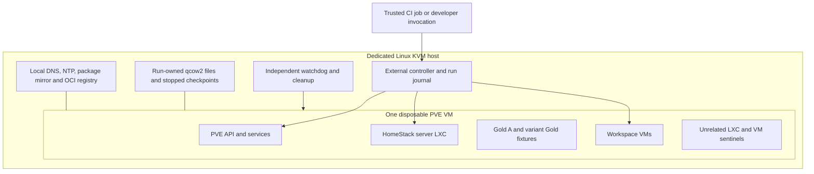

# Isolated end-to-end test laboratory

**Status:** design proposal; no infrastructure is provisioned by this document.
**Date:** 2026-10-16
**Repository baseline:** `9f239ee` on `rust-migration`.

## 1. Objective and decisions

Build an automated laboratory that creates **one disposable Proxmox VE node**,
prepares Gold VMs, installs HomeStack, exercises real VMs and LXC containers,
injects destructive failures, verifies the resulting state, and removes the
entire laboratory. No existing cluster, Gold, workspace, credentials or user
data are inputs.

The architecture must remain inexpensive to change as HomeStack evolves.
Laboratory provisioning, product installation and feature scenarios are separate
modules. A new feature normally needs one scenario module and, when necessary,
one fixture builder. Changes to the product's packaging or installation affect
the product driver rather than every scenario.

The initial decisions are:

| Area | Decision |
|---|---|
| Execution host | Dedicated Linux host with KVM/libvirt; no production workloads |
| Proxmox | One nested, disposable PVE VM at a time, installed automatically from a locked ISO |
| Controller | Runs outside PVE, on the execution host; survives destruction of the tested node |
| Workloads | Actual QEMU/KVM VMs and unprivileged PVE LXC containers |
| Isolation | Private virtual networks, local test services, disposable disk files and fresh credentials |
| Test entry points | Built product binaries, HTTPS API, and selected terminal UI flows |
| Independent checks | Direct PVE reads, guest SSH, filesystem checks and host inventory |
| Recovery | Restore a stopped laboratory checkpoint or rebuild; no automatic product rollback |
| Scheduling | One run and one scenario at a time on the host |
| Implementation | A small Rust controller in `crates/hs-e2e`; ordinary Rust scenario functions |
| Evolution | Test the current product contract; remove obsolete paths instead of preserving old versions |

The host is a prerequisite, not a second Proxmox instance. The controller creates
the tested PVE VM itself. This design deliberately does not attach a disposable
node to an existing cluster.

## 2. Current implementation and the missing layer

HomeStack already has unit tests, simulated PVE scenarios, parity checks and
tests against a live cluster. The new laboratory supplies the missing lifecycle:
**create the infrastructure and all prerequisites before testing the product**.

| Existing component | Evidence and implication |
|---|---|
| Local checks and live orchestration | [`scripts/check.sh`](../scripts/check.sh) runs L1–L3 locally and several mutating live gates with `--live`; that option must not be treated as read-only |
| Workspace lifecycle | [`live_lifecycle.rs`](../crates/hs-server/tests/live_lifecycle.rs), `live_refresh.rs`, `live_resize.rs` and `live_addkey.rs` already supply useful assertions, but depend on prepared configuration, Gold and reserved IDs |
| Installation | [`hs-install`](../crates/hs-install/src/lib.rs) and the [CLI installer](../crates/hs-cli/src/installer.rs) support root access to PVE over SSH for installation |
| Server deployment | [`hs-deploy`](../crates/hs-deploy/src/deploy.rs) creates actual server containers through the PVE API |
| Deployment gates | [`live_deploy.rs`](../crates/hs-deploy/tests/live_deploy.rs) and [`live_cli.rs`](../crates/hs-cli/tests/live_cli.rs) assume existing files and multiple server instances |
| Terminal UI | [`live_tui.rs`](../crates/hs-cli/tests/live_tui.rs) exercises action code; a real binary driven through a PTY is still needed to cover terminal input and rendering integration |
| Known deployment regressions | [Container replacement audit](container-replacement-audit.md) identifies network normalization, container identity and batch consistency cases |

These are observations about the baseline revision, not permanent assumptions
about the product. Existing live tests must not be pointed at a new environment
by exporting a few environment variables: their hardcoded topology, paths and
resource checks need to be understood and replaced in the scenarios being moved.
Local tests and simulations remain useful and continue to run before E2E.

## 3. Topology and trust boundary



PVE is L1; its workspace VMs are L2. The execution host must expose nested
virtualization and host CPU capabilities to PVE. Checking CPU flags alone is
insufficient: preflight must boot an actual L2 KVM guest. This follows the
[Linux nested KVM requirements](https://docs.kernel.org/virt/kvm/x86/running-nested-guests.html).
Software emulation does not qualify for this suite.

The permitted destruction boundary includes every disk, VM, container, token,
pool, snippet, service and network setting **inside this disposable PVE VM**.
It includes rebooting, killing or deleting the PVE VM from L0. A broken PVE API
must never prevent the controller from removing the VM and its backing files.

The boundary excludes L0's system disks, its management interface, the controller,
artifact storage and shared immutable downloads. PVE receives file-backed disks
only: no physical disks, host directory mounts, host sockets, USB devices, GPU
passthrough or production storage connections. The normal PVE security profile
and unprivileged containers remain enabled.

This contains mistakes and destructive infrastructure tests. It is not a
guarantee against a hypervisor escape; only trusted source revisions run on this
host, and the host holds no production secrets.

### Initial capacity

Start with the following budget and adjust it using measured run data:

| Resource | Initial allocation |
|---|---|
| L0 | 16 CPU threads, 64 GiB RAM, 500 GiB dedicated SSD test storage |
| PVE VM | 8 vCPU with host passthrough, 32 GiB RAM, fixed memory |
| PVE disks | 64 GiB system, 160 GiB workload storage, 16 GiB fault-test storage |
| Nested guests | Normally 2 vCPU and 2 GiB each; sequential provisioning |
| Host reserve | At least 16 GiB RAM and 20% free test storage before admitting a run |

These are design estimates, not measured minimums or performance promises.
Outer memory, CPU, disk and I/O limits apply even if root inside PVE changes
its own limits. Filling test storage must stop the run before filling L0.

## 4. Network, credentials and target validation

### Networks

Create two libvirt networks without a physical uplink or a forwarding element:

| Network | Participants | Purpose |
|---|---|---|
| Management | Controller, fixture services, PVE management NIC | Installation SSH, PVE HTTPS and image/package retrieval |
| Workload | Controller, fixture services, PVE's second NIC bridged to its guests | HomeStack HTTPS, workspace SSH and guest networking |

The workload bridge inside PVE has no PVE management address. The controller can
reach both networks directly. PVE and guests use fixed lab addresses and the
local resolver; names end in `<run-id>.e2e.test`. Subnets are selected after
checking L0's routes, VPNs and existing networks for overlap.

An isolated libvirt network still permits traffic to its host, as the
[libvirt network documentation](https://libvirt.org/formatnetwork.html#isolated-network-config)
explains. Therefore L0 firewall rules are mandatory: allow only established
responses and the specific fixture DNS, NTP, mirror and registry ports from lab
interfaces. Permit the HomeStack service containers to reach only this run's
PVE management address on TCP 8006, with the return route through L0. Deny
other host services, all forwarding to external networks and other crossings
between workload and management. Apply the rules to IPv4, IPv6 and bridged
traffic; disable IPv6 on lab interfaces in v1 if it is not covered by the rules.
Do not use default libvirt NAT as an isolation boundary.

PVE root could reconfigure either of its NICs. Isolation therefore depends on
the externally enforced interface boundary, not addresses or rules inside PVE.
The fixture services expose read-only content on lab addresses; their management
interfaces are not reachable from either lab network.

Downloads happen on L0 before the run. A local read-only package mirror and a
real OCI registry supply locked packages and images to PVE and guests. Guests
have no general Internet access. The registry serves the actual HomeStack image
built from the revision under test, over TLS. Its CA is installed in the lab
PVE trust store. Registry push access is restricted to the build process.

### Credentials

Every run creates its own root bootstrap SSH key, workspace keys, PVE tokens,
client bearer token and test certificate authority. No desktop SSH agent,
personal configuration, DNS provider key or production token is inherited.
Run product commands in a private home and XDG directory, with an explicit
environment allowlist and dedicated SSH configuration and `known_hosts` files.
Do not overwrite the invoking user's home environment.

Verify the initial PVE SSH identity and PVE CA through the trusted L0 console
or another provisioning channel bound to the exact VM UUID; do not discover
trust by accepting an arbitrary network endpoint. Verify HTTPS certificates and
SSH host keys throughout the suite. Keep CA signing keys outside PVE. Private
files use mode `0600`, their directories `0700`, and disappear during cleanup.
Automated SSH tests use synthetic software keys; hardware key behavior is a
separate coverage limitation.

### Guard before mutation

The controller never accepts a user-supplied PVE endpoint, an existing domain
to adopt, or an unrestricted libvirt URI. It creates a run identity and derives
its target from a locally recorded libvirt UUID, disk paths, virtual NICs,
addresses and console-established certificate identity.

Before enabling product mutation, verify:

1. A host-wide lock is held and the run journal exists on L0.
2. The exact PVE domain belongs to this run and all writable disks are regular
   files under its run directory, with no symlink or backing-file escape.
3. Its NICs connect only to this run's isolated networks; host firewall and
   absence of an uplink have been checked.
4. Network access from inside PVE and a disposable guest to L0 management and
   a controlled external test destination is blocked, while service containers
   can reach the intended PVE HTTPS API. Do not probe production.
5. Console identity, pinned TLS identity, expected hostname and single-node
   PVE inventory agree. No cluster join or external storage is present.

Names, tags, ID ranges and an `allow_destroy` setting are useful diagnostics,
but are not proof of isolation. Root fault actions receive authority for this
run's PVE only. The product receives only the tokens generated by its real
installer; it never receives the controller's administrative connection.

## 5. Complete run lifecycle

The initial version always performs a fresh PVE installation for each run.
There is no shared PVE or preinstalled HomeStack image cache. Reuse within a
run uses stopped checkpoints; immutable ISO, package and cloud-image downloads
may be shared by content hash.

| Stage | Action | Required evidence |
|---|---|---|
| 1. Admit | Acquire lock, allocate run directory and journal, check capacity and nested KVM | Host checks and recorded resource ownership |
| 2. Build | Build CLI, deploy tool and server image from the same source revision | Source SHA, dirty-tree status, binary hashes and OCI digest |
| 3. Provision PVE | Prepare unattended ISO, create guarded networks, disks and NICs, install and boot PVE | Installer console, installed package versions and working PVE API |
| 4. Verify boundary | Set up local names, time, trust and storage; verify isolation and nested KVM | Passing identity and isolation checks and a booted L2 guest |
| 5. Prepare Gold | Import locked cloud image, configure guest contract, boot and verify | PVE configuration, successful guest boot and independent contract checks |
| 6. Install HomeStack | Run the real installer and deployment binaries | Real roles, pools, tokens, snippets, LXC and client configuration |
| 7. Test | Restore the declared baseline, arrange resources, act and assert | Product results plus independent state evidence |
| 8. Collect | Export sanitized evidence after each scenario and on failure | Per-scenario report and logs outside PVE |
| 9. Destroy | Remove run-owned L0 resources, even if PVE is unavailable | Verified absence of domain, writable disks, networks and temporary secrets |
| 10. Report | Publish test and cleanup results | Machine-readable report and nonzero status on failure |

PVE supports unattended installation with an answer file and a prepared ISO;
use that mechanism rather than automating GUI clicks. See the
[official installation source](https://github.com/proxmox/pve-docs/blob/master/pve-installation.adoc#unattended-installation).
Validate the answer file with the assistant matching the locked ISO. Select
the disposable system disk by its assigned identity, not a broad disk glob.
Detach installation media after provisioning; it contains temporary credentials.

Create local directory storage for snippets/templates, LVM-thin storage for
normal VM/container disks, and a separate bounded storage device for capacity
and corruption tests. PVE system storage is not the target of ordinary
out-of-space tests. Whole-node corruption tests use a baseline that can be
discarded from L0.

### Gold preparation

HomeStack does not build Gold operating systems today. The laboratory owns a
small reproducible builder, independent of HomeStack's readiness implementation:

1. Verify the cloud-image checksum and import it as a new QEMU VM.
2. Prepare the current [Gold guest contract](../README.md#preparing-a-gold-vm):
   `scsi0` root, `net0`, Cloud-Init, QGA, NetworkManager, required utilities,
   one regular workspace account and synthetic public keys. No persistent-home
   disk and no root escalation for the workspace account.
3. Boot, wait for Cloud-Init and QGA, and verify the contract through guest SSH.
4. Create distinguishable root markers for Gold A and, when a scenario needs
   it, Gold B. Clean Cloud-Init state and machine identity using the image's
   supported preparation procedure, then stop the VM.
5. Call the real HomeStack Gold readiness endpoint after installation and
   assert the required checks. Guest checks require a running Gold; test both
   running and stopped behavior explicitly.

Additional Gold variants are builders with a concrete test purpose: Btrfs,
partitioned root/home, LVM, LUKS or a deliberately invalid guest contract.
The controller selects only the fixtures required by the selected scenarios.
It must not download mutable images or build every variant for a smoke run.

### A required product change: local certificate input

At the baseline revision, [`servers.rs`](../crates/hs-cli/src/servers.rs)
discovers a public DNS provider and drives ACME. The
[deployment configuration](../crates/hs-deploy/src/config.rs) requires an OVH or
Spaceship configuration even when `apply` uses a stored certificate.
This prevents a fully isolated test of the complete installer as currently
implemented. Local certificate support is an implementation prerequisite,
not an existing feature of this repository.

Add one explicit, supported certificate input: a PEM certificate, private key
and trust CA supplied by the caller. In this mode the installer and deployer
must not discover a public DNS provider, require its credentials, or contact
ACME. Validate name coverage, key matching and expiry, and preserve normal TLS
verification. Use the same deployment and HTTPS bootstrap path afterwards.
The existing ACME path remains available for actual public certificate issuance;
update configuration directly rather than introducing legacy parsing fallbacks.
The final option names are determined when implementing this product change.

The lab then uses local DNS and a fresh certificate for its own names. It does
not fake DNS-provider responses, store dummy provider keys, replace the installer
with a test implementation, or use `--no-servers` to claim a complete install.
Real public ACME/DNS issuance remains a separately reported external integration
test, outside the default isolated suite.

## 6. Baselines, checkpoints and cleanup

Maintain three named baselines within the run:

| Baseline | Contents | Typical use |
|---|---|---|
| `pve-ready` | PVE, local trust/network/storage; no Gold or HomeStack | Gold builders and installation tests |
| `gold-ready` | PVE plus verified Gold A; HomeStack not installed | Installer, cancellation and uninstall scenarios |
| `homestack-ready` | Verified Gold and a real installed HomeStack server | Workspace, deployment and fault scenarios |

A baseline is created only after stopping all inner guests and shutting down
PVE. Record every PVE disk and any writable firmware state as one checkpoint
set. Seal those files read-only and create new qcow2 overlays for the next
scenario. Do not copy active disks or take nested VM memory snapshots.

Restore is controlled from L0: collect evidence, stop or forcibly terminate
PVE if necessary, discard the scenario overlays, create fresh overlays from
the chosen baseline and boot PVE. Never restore a mixture of baseline disks.
Checkpoints remain private to the run and are deleted at its end. After a
restore, discard product sessions, reconnect, and recheck boot identity and
readiness; do not reuse plans or job IDs held in controller memory.

Each scenario starts from its declared baseline. Scenarios do not depend on
previous scenarios' side effects. A failure during baseline creation blocks
its dependents with an explicit reason and prevents a green result.

### Three cleanup mechanisms

1. **Scenario cleanup:** where the product is healthy, use its destroy/remove
   operations and verify guest, volume and snippet inventory before restoring
   a checkpoint. This tests cleanup semantics rather than hiding leaks with
   an outer reset.
2. **Run cleanup:** always remove the exact L0 domain, overlay/checkpoint disks,
   installation media, networks, fixture processes, firewall rules, private
   home and secrets recorded in the run journal. This requires no working PVE.
3. **Independent watchdog:** a host service outside the test process observes
   the run lease and deadline. It handles killed controllers, cancelled CI jobs
   and host reboot recovery, using the journal to resume idempotent cleanup.

Register an intended resource in the L0 journal before creating it, then record
its actual UUID/path after success. Write the journal atomically and durably.
Cleanup reconciles the exact recorded identity with L0 metadata; it never
deletes arbitrary resources by prefix or recursively follows guest-supplied
paths. A restarted controller cleans an interrupted run instead of resuming
an unknown product operation.

Initial limits are a two-hour run deadline, a separate ten-minute cleanup
budget and a five-minute watchdog detection window. A developer may request
failure retention explicitly, limited to one hour beyond failure and within
the host's storage quota. The default is to preserve evidence and destroy the
lab. Retention does not turn off network isolation or the watchdog.

Report test outcome and cleanup outcome separately. If both fail, keep both
errors; cleanup must not overwrite the original failure. An uncleared host is
quarantined from new jobs until reconciliation succeeds.

## 7. Extensible implementation without a test framework of its own

Use one Rust crate and explicit modules. The layout below is proposed, not
present in the repository today:

```text
crates/hs-e2e/
  src/main.rs                 # select scenarios, run, report
  src/lab.rs                  # libvirt lifecycle, identity guard, reset
  src/journal.rs              # ownership and cleanup records
  src/fixtures.rs             # baseline and resource builders
  src/product.rs              # current CLI/API install and feature operations
  src/probe.rs                # independent PVE and guest observations
  src/faults.rs               # bounded fault injection and undo
  src/report.rs               # steps, artifacts, JUnit and JSON
  src/scenarios/mod.rs        # explicit scenario registration
  src/scenarios/install.rs
  src/scenarios/workspace.rs
  src/scenarios/deployment.rs
  src/scenarios/destruction.rs
e2e/inputs.lock.toml           # current ISO/image/package/tool input hashes
```

### Module contracts

| Module | Owns | Must not own |
|---|---|---|
| Lab | Creation, target identity, networks, outer disks, reset, final destruction | Workspace behavior or product success assertions |
| Fixtures | Reusable preparation of concrete starting states | Hidden execution of the feature being tested |
| Product | Current installer/deployer/CLI/API calls and decoding their outputs | Privileged repair, host resource destruction or independent expected results |
| Probe | PVE inventory and direct guest/filesystem checks | Calling product internals to calculate what success should mean |
| Faults | Explicit PVE/guest/process/storage disruptions with bounded targets | Generic access to unrelated host resources |
| Scenario | Preconditions, action, expected results and recovery assertions | Reimplementing provisioning and common cleanup |

The product driver launches built binaries for the user journey and sends
real HTTPS requests for protocol-specific scenarios. It does not call
`hs_core::create_workspace` instead of the deployed service. Sharing PVE
transport types is acceptable, but expected results come from assertions and
independent observations, not the lifecycle implementation under test.

Each registered scenario has only:

- a stable descriptive ID;
- a profile: `smoke`, `full` or `destructive`;
- a baseline and explicit fixture requirements;
- a deadline;
- an ordinary async Rust function receiving the run context.

The context exposes the lab, product driver, probes, bounded faults, resource
allocator and step reporter. Keep its types concrete. Do not add dynamic plugin
loading, a workflow DSL, a dependency graph engine, generic backend traits or
adapters for historical product versions. An explicit list of scenario
functions and a few fixture builders are sufficient.

Allocate guest IDs and addresses from the run context. Scenarios refer to
resource handles returned by fixtures, not VM 240, Gold 248, CT 999 or a
developer's absolute paths. Product-defined roles, pools and tags remain the
real product values. Lab run labels are additional metadata and are not
injected into product configuration if the product does not support them.

### Adding and changing features

For a new capability such as workspace snapshots:

1. Implement its normal public product interface.
2. Add the current operation to `product.rs` if multiple scenarios need it.
3. Add a scenario that creates a workspace, writes data, invokes the public
   snapshot operation and verifies the observable state independently.
4. Reuse the existing Gold/workspace builders and automatic reset. Add a new
   fixture only if a genuinely different starting state is required.
5. Register the scenario and place it in the required profile. Add fault cases
   only for meaningful interruption points.

The lab lifecycle and final cleanup need no changes. If HomeStack later changes
from LXC packaging to another deployment model, update the product installer
driver and deployment-specific assertions; Gold, workspace and L0 isolation
scenarios retain their intent. If the public contract itself changes, update
its callers and assertions in the same change and remove obsolete paths.

Fixture requirements describe current environment needs, such as `luks-home`
or `two-service-instances`; they are not version compatibility flags. A required
capability missing from the selected product revision is a failure. Unsupported
scope, such as node migration with one PVE node, is listed in the coverage
report and never silently counted as passed.

## 8. Scenario catalogue and assertions

`full` includes `smoke`; `destructive` includes `full` plus disruption scenarios.
All three profiles create a new PVE VM from the locked ISO. Tests within a
profile run sequentially and restore their baselines independently.

| ID / area | Profile | Action and required observations |
|---|---|---|
| `lab.cold-install` | smoke | Install PVE, boot a nested KVM guest, verify boundaries and local service access |
| `gold.build-and-readiness` | smoke | Build Gold from the locked image, verify guest contract, then verify product readiness with Gold running and stopped |
| `install.complete` | smoke | Run the full CLI installer with local PEM input; inspect real pools, roles, ACLs, snippets, server LXC, TLS and usable generated client config |
| `workspace.lifecycle` | smoke | CLI plan, create, boot, status and destroy; verify Cloud-Init, QGA, SSH, root/home mounts and absence of leaked disks |
| `workspace.refresh` | smoke | Write home canaries and a disposable root marker, refresh; home remains intact, root comes from Gold, host keys and local client files reconcile |
| `gold.invalid` | full | Remove one required guest capability or break a PVE prerequisite at a time; readiness/installation refuses before the prohibited mutation |
| `gold.selection` | full | Introduce Gold B and ambiguous/incorrect tags; explicit selection works, ambiguous or invalid selection is refused |
| `install.repeat-and-cancel` | full | Repeat installation, dry-run and cancel; verify intended idempotency and no mutation on cancelled plans |
| `install.uninstall-reinstall` | full | Uninstall leaves guests and required snippets intact; reinstall adopts the intended lab resources and restores working access |
| `workspace.home-integrity` | full | Preserve files, hashes, permissions, owners, links and a synthetic SQLite workload across repeated refresh and guest reboot |
| `workspace.resize` | full | Grow root and home independently; check virtual disk, layers and usable filesystem size; reject shrink/unsupported layouts without mutation |
| `workspace.resize-layouts` | full | Exercise supported GPT, Btrfs/subvolume, LVM and LUKS key-file layouts; use a PTY for the synthetic interactive passphrase case |
| `workspace.addkey` | full | Running/stopped guest behavior, explicit restart, authorization, preservation of existing keys and unchanged home data |
| `workspace.plan-races` | full | Change config or VM digest between plan/apply; reject stale input; repeated apply does not duplicate destructive work |
| `workspace.concurrent-jobs` | full | Competing actions through two service instances obey leases; losing action performs no forbidden mutation |
| `pool.boundary` | full | Synthetic unrelated VM/LXC sentinels outside managed pools remain intact and inaccessible to the product token |
| `deploy.repeat` | full | Repeat identical deployment after PVE normalizes `net0`; original container identity and uptime remain, no delete task or disk replacement |
| `deploy.collision` | full | Put an unrelated LXC at the intended CTID inside a visible pool; deployment refuses without stop/delete; sentinel data survives |
| `deploy.replace` | full | Deploy a second real OCI image variant of the tested revision; CTID/IP are reused and TLS/config/secrets are provisioned again |
| `deploy.batch` | full | Two service LXCs on the one PVE node receive changed config; batch reaches both before global consistency validation |
| `client.instance-loss` | full | Stop one of two service LXCs; reads use the other; a plan/job tied to the lost instance is reported, not replayed elsewhere |
| `tui.user-journey` | full | Drive the built binary through a PTY: open, review, cancel, create, refresh and destroy; verify real state and local files |
| `setup.files-and-state` | full | Apply synthetic files/config through the real setup interface; verify guest content, recorded state, rerun and cancellation |
| `fault.guest-loss` | destructive | Remove or damage a workspace externally; status and operations report actual missing resources and never format an existing home to repair it |
| `fault.service-kill` | destructive | Kill the actual HomeStack process during refresh/resize at a recorded stage; reconnect and retry only as the current operation contract allows |
| `fault.qga-cloudinit` | destructive | Stop QGA, break Cloud-Init or remove a required vendor snippet; error identifies the failed stage and preserves home data |
| `fault.capacity` | destructive | Exhaust only the bounded fault storage; task fails within deadline without host exhaustion or sentinel damage |
| `fault.registry-or-network` | destructive | Deny a registry pull or one service network path; deployment reports failure; a deliberate later reapply can recreate a missing server |
| `fault.node-loss` | destructive | Reboot, power off or delete PVE from L0 during work; controller reports interruption, exports available evidence and removes all outer resources |
| `lab.controller-loss` | destructive | A trusted external harness kills the controller or cancels its job; watchdog removes the lab, including after a simulated host-service restart |

The deployment repeat, collision and batch cases should expose the open issues
in the existing audit. Do not mark those regressions as expected passes to
obtain a green suite. On one PVE node, two service LXCs are a deliberately
constructed fixture for application-level behavior; this does not validate
node redundancy or the installer's multi-node discovery.

For `setup`, the initial scope is first-party file/configuration behavior using
synthetic data. Current repository provisioning explicitly calls GitHub through
[`setup/catalog.rs`](../crates/hs-cli/src/setup/catalog.rs) and
[`setup/repo.rs`](../crates/hs-cli/src/setup/repo.rs); it cannot be validated by
substituting a local Git server. Real GitHub provisioning, third-party app
installers, Herdr desktop registration and hardware FIDO touches require
separate declared integration scenarios. A fake external response must not be
presented as proof of those real integrations. If local repository support is
added to the product later, its E2E scenario can use a local repository fixture.

### Observation rules

Every scenario checks the public result and the resulting resources. For example,
`workspace.refresh` must compare home canaries and filesystem identity before
and after refresh, verify the Gold root marker, and inspect the PVE disk layout.
A successful HTTP response or a `done` job is not sufficient.

Use guest SSH as a separate observation channel for QGA-driven operations.
For refusal/cancellation tests, compare inventory, configuration digests, guest
canaries and PVE task history around the attempted action. Keep sentinel
resources in the same storage and, for collision tests, the same visible pool,
so permission boundaries cannot hide a product identity bug.

Keep the fault scenario's expected outcome explicit. A server may remain absent
after a destructive replacement fails; the accepted deployment model uses
manual reapply, not automatic rollback. Plans and jobs currently live in memory,
so a restart may lose their IDs. Verify the documented error and recovery path
rather than assuming persistent jobs or exactly-once execution across restart.

Inject faults after an observable real stage, such as a recorded PVE UPID,
job event or disk configuration transition. Bound the wait for that stage.
Do not use a guessed sleep to claim a crash happened during a critical step.
Restarting an interrupted operation is a separate recorded action, not an
automatic retry that turns the initial failure green.

Synthetic SQLite data may be created in the lab to test preservation/backup.
When a consistent database copy is needed, use SQLite `.backup` or its Online
Backup API, never plain `cp`. Migration experiments, if added, run only on a
temporary backup and require `PRAGMA integrity_check` afterwards. No user
database is an input.

## 9. Inputs, reports and CI

### Reproducibility

Commit an input lock file with the exact PVE ISO and checksum, guest image and
checksum, package snapshot identity, toolchain, controller dependencies and
fixture service images/digests. The baseline currently requires PVE 9.2 or
later in [`checks.rs`](../crates/hs-install/src/checks.rs); choose an available
exact supported ISO when implementing the lab and record installed package
versions. Do not resolve `latest` or upgrade packages during a scenario.

Build the CLI and server image from the same tested checkout. Record its commit
and whether it contains local changes. Publish the image to the local registry
under an immutable run tag and record its OCI digest, even if the current product
interface consumes a tag. For replacement tests, build a second real image of
the same binaries with different OCI build metadata and record both digests.
This exercises image replacement without maintaining historical binaries or
configuration compatibility. New architecture requirements update the lock and
fixtures in the same change; do not preserve an old product deployment path.

### Evidence

Write artifacts incrementally to L0 so a deleted node does not erase all
evidence. Record step names, durations, deadlines, target handles, sanitized
commands, exit status, request IDs, configuration hashes, PVE task UPIDs and
event timestamps. Collect guest boot IDs and before/after inventories.

On failure, collect what is still reachable: PVE task logs and service journal,
HomeStack structured logs and job events, Cloud-Init/QGA status, guest filesystem
information, serial console, outer domain status and resource usage. A guest
or PVE collection timeout must not delay outer cleanup indefinitely.

Secrets, private keys, bearer headers and TLS bootstrap environment values are
excluded at collection time. Do not archive whole container configurations,
homes or disk images as normal CI artifacts. Keep sanitized evidence for 14
days initially. Retained disks remain restricted on L0 and obey the shorter
failure-retention deadline.

Emit JSON and JUnit, with separate test and cleanup results. Distinguish
`passed`, `failed`, `blocked` and `out_of_scope`. Distinguish infrastructure
setup failure from product assertion failure. A required blocked scenario,
missing evidence, exceeded deadline or incomplete cleanup makes the run fail.

### Execution policy

Proposed controller commands, to be implemented:

```sh
cargo run --locked -p hs-e2e -- run --profile smoke
cargo run --locked -p hs-e2e -- run --profile full
cargo run --locked -p hs-e2e -- run --profile destructive
cargo run --locked -p hs-e2e -- run --scenario workspace.refresh
```

Do not add a free-form endpoint flag. Scenario selection still provisions and
destroys a lab. Normal `cargo test --workspace` never provisions infrastructure.
Python fixture tooling, if needed, uses `uv run`/`uv sync` or `uv pip`, never
plain `pip`.

Run local checks on ordinary CI first. Run smoke on trusted reviewed changes,
full nightly and before a release, and destructive on schedule or explicit
developer invocation. Add a single E2E workflow with a dedicated runner label,
host-wide concurrency lock, outer timeout and artifact upload on failure.
An independent host watchdog remains necessary even with an `always()` CI
cleanup step. Do not run privileged jobs from untrusted forks or use a
privileged `pull_request_target` checkout of unreviewed code.

Measure stage timings and resource consumption before setting performance
gates. The initial two-hour deadline is an execution bound, not a service
performance acceptance criterion. Do not rerun a failed product scenario
automatically; preserve its result and allow a separately identified rerun.

## 10. Delivery order and acceptance criteria

| Step | Deliverable | Exit condition |
|---|---|---|
| 1. Isolated shell | L0 setup, controller journal, ISO installer, network guards and watchdog | PVE and an L2 guest boot; controller/node kill leaves no outer resources; blocked routes are demonstrated |
| 2. Product prerequisites | Local PEM certificate input and reproducible local OCI/image/package supply | Real full installer requires no public account, verifies TLS, and installs the exact revision |
| 3. First complete journey | Gold builder, actual install, create, refresh and destroy | Guest data and independent inventory checks pass twice in fresh runs; cleanup passes |
| 4. Maintainable catalogue | Baselines, fixture handles, explicit scenario registration, reports | A new feature scenario can be added without editing L0 provisioning or final cleanup |
| 5. Current function coverage | Resize layouts, keys, uninstall/reinstall, deployment regressions, PTY and local setup | Required `full` scenarios pass; unsupported external integrations are clearly listed |
| 6. Destruction and CI | Stage-triggered faults, controller kill harness, scheduled runs | Node/API/controller loss is bounded; evidence survives and watchdog cleanup is proven |

The laboratory is accepted when:

- A clean checkout plus locked input downloads and the dedicated L0 host are
  enough to run it; no prepared PVE, Gold, personal files or production accounts
  are required.
- A run creates exactly one tested PVE node and real nested VMs/containers,
  including a freshly built Gold and a genuinely installed HomeStack service.
- Destruction can target any resource inside that node, and destruction of the
  node itself cannot strand resources outside the controller's cleanup scope.
- The real public interfaces and independently observed data agree; leaked
  guest resources cannot be hidden by checkpoint reset.
- Killing the controller, cancelling the job and losing the PVE API all result
  in bounded cleanup, with failures visible in the report.
- A contributor can add one ordinary scenario using existing fixtures without
  changing the laboratory lifecycle. Current architecture changes update a
  small driver/fixture surface instead of copying obsolete paths.
- Required failures and unreported coverage gaps cannot produce a misleading
  green result.

## 11. Explicit limits

One node validates the single-node lifecycle. It cannot validate cross-node
creation/migration, quorum, fencing, HA, real node failover, shared storage or
Ceph. Those need a later, explicitly requested multi-node topology; two server
containers on one PVE node do not provide that evidence.

Nested KVM does not validate physical passthrough, real device failure or
bare-metal performance. Public certificate issuance, external service logins,
third-party application installers and physical FIDO interactions are outside
the default isolated suite and must remain visible in its coverage report.

The execution host still needs to be selected and checked for nested KVM and
capacity before implementation can be exercised. There is no authorization or
instruction in this document to change the user's existing cluster.
